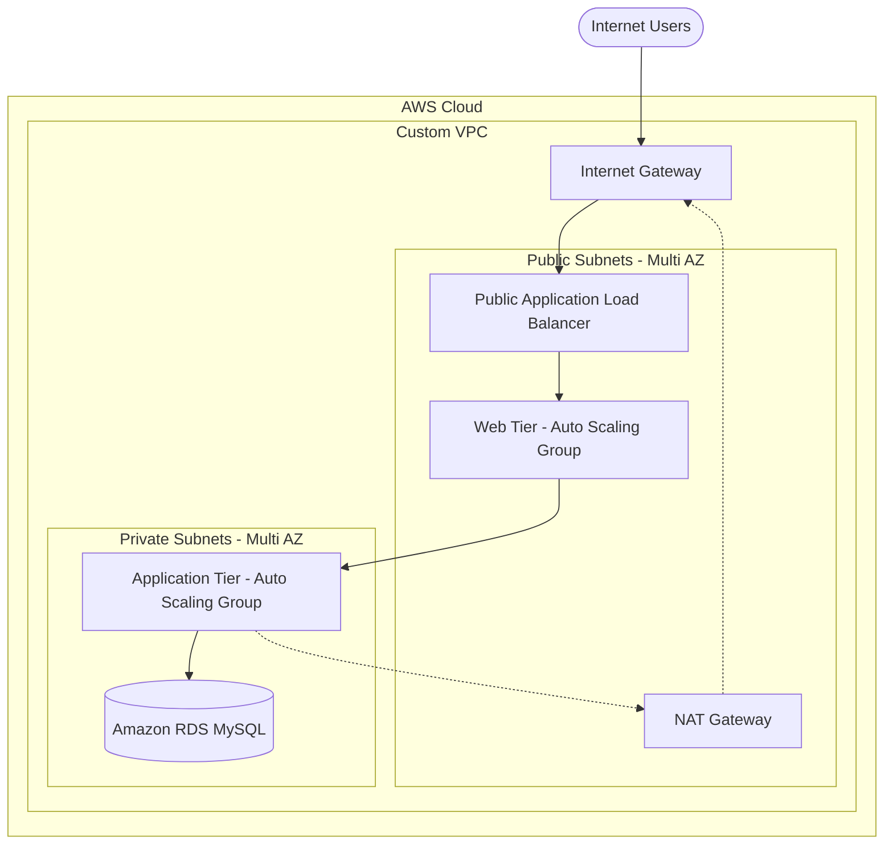

# 🚀 Terraform 3-Tier AWS Infrastructure

Deploy a scalable, secure, and modular **3-Tier AWS Infrastructure** using Terraform, AWS EC2, Auto Scaling Groups, Application Load Balancer, VPC, NAT Gateway, and Amazon RDS MySQL.

## 🏗️ Architecture Diagram



> **Note:** This is a logical architecture diagram. Actual web-to-app connectivity must be configured through application endpoints, such as an internal load balancer. The NAT Gateway provides outbound connectivity for private subnets.

## 📌 Project Overview

This project provisions AWS infrastructure using reusable Terraform modules.

### Key Features

- Custom AWS VPC
- Public and Private Subnets
- Internet Gateway
- NAT Gateway
- Public Application Load Balancer
- Web Tier Auto Scaling Group
- Application Tier Auto Scaling Group
- Private Amazon RDS MySQL Database
- Security Groups for each tier
- S3 Remote Terraform State Backend
- Modular Terraform Architecture

## 📂 Project Directory Structure

```text
Terraform-3-Tier-AWS/
│
├── backend.tf
├── main.tf
├── variables.tf
├── terraform.tfvars
├── outputs.tf
├── README.md
│
└── modules/
    ├── network/
    │   ├── main.tf
    │   ├── variables.tf
    │   └── outputs.tf
    │
    ├── web/
    │   ├── main.tf
    │   ├── variables.tf
    │   └── outputs.tf
    │
    ├── app/
    │   ├── main.tf
    │   ├── variables.tf
    │   └── outputs.tf
    │
    └── db/
        ├── main.tf
        ├── variables.tf
        └── outputs.tf
```

## 🛠️ Technologies Used

| Technology | Purpose |
|------------|---------|
| Terraform | Infrastructure as Code |
| AWS VPC | Network Isolation |
| AWS EC2 | Compute Instances |
| AWS ALB | Load Balancing |
| AWS ASG | Automatic Scaling |
| AWS RDS | MySQL Database |
| AWS S3 | Remote State Storage |
| AWS IAM | Access Management |
| AWS NAT Gateway | Private Subnet Outbound Access |
| GitHub | Version Control |

## ⚙️ Prerequisites

Before deploying, install and configure:

- Terraform >= 1.5.0
- AWS CLI
- AWS Account
- Git
- VS Code
- Existing S3 Bucket for Terraform State
- Valid AMI IDs in the selected AWS Region

Configure AWS CLI:

```bash
aws configure
```

Verify AWS credentials:

```bash
aws sts get-caller-identity
```

## 🔧 Terraform Configuration

Update the `terraform.tfvars` file:

```hcl
aws_region = "ap-south-1"

web_ami_id = "ami-xxxxxxxxxxxxxxxxx"

app_ami_id = "ami-xxxxxxxxxxxxxxxxx"

db_username = "admin"
```

Provide the database password securely, for example:

```bash
export TF_VAR_db_password="YOUR_SECURE_PASSWORD"
```

Avoid committing passwords, AWS credentials, or Terraform state files to GitHub.

## 🚀 Deployment Steps

### Step 1: Clone Repository

```bash
git clone https://github.com/YOUR_USERNAME/Terraform-3-Tier-AWS.git

cd Terraform-3-Tier-AWS
```

### Step 2: Initialize Terraform

```bash
terraform init
```

### Step 3: Format Terraform Files

```bash
terraform fmt -recursive
```

### Step 4: Validate Configuration

```bash
terraform validate
```

### Step 5: Review Terraform Plan

```bash
terraform plan -var-file="terraform.tfvars"
```

### Step 6: Deploy Infrastructure

```bash
terraform apply -var-file="terraform.tfvars"
```

Type `yes` when prompted.

## 🔍 Verify Infrastructure

Check Terraform-managed resources:

```bash
terraform state list
```

Display Terraform outputs:

```bash
terraform output
```

Check the ALB DNS name:

```bash
terraform output web_alb_dns
```

Check the RDS endpoint:

```bash
terraform output db_endpoint
```

## 🔐 Security Architecture

### Web Tier

- Public-facing Application Load Balancer
- HTTP/HTTPS access through ALB
- Web EC2 security group restricted to required traffic

### Application Tier

- EC2 instances deployed in private subnets
- No direct inbound internet access
- Application access restricted to the Web Tier

### Database Tier

- MySQL RDS deployed in private subnets
- Database is not publicly accessible
- Port 3306 access restricted to the Application Tier
- Database credentials handled securely

## 📈 Auto Scaling

The Web and Application tiers use AWS Auto Scaling Groups.

Benefits:

- Improved Availability
- Automatic Instance Replacement
- Horizontal Scaling
- Better Traffic Handling
- Multi-AZ Deployment Support

Scaling policies and instance refresh behavior depend on the Terraform module configuration.

## 🗄️ Amazon RDS MySQL

Database features:

- MySQL Database Engine
- Private Database Subnets
- Database Security Group
- Configurable Instance Type
- Configurable Backup Retention
- Optional Multi-AZ Deployment

Default configuration:

```hcl
db_instance_class    = "db.t4g.micro"
db_multi_az          = false
db_backup_retention  = 0
```

> Multi-AZ is disabled by default. Enable it when high availability is required. AWS resources may incur charges even with these defaults.

## ☁️ Terraform Remote State

Terraform state is stored in an existing Amazon S3 bucket.

Example `backend.tf`:

```hcl
terraform {
  backend "s3" {
    bucket       = "YOUR-EXISTING-STATE-BUCKET"
    key          = "three-tier/terraform.tfstate"
    region       = "ap-south-1"
    encrypt      = true
    use_lockfile = true
  }
}
```

Create the bucket before initializing Terraform.

Ensure the IAM identity has the required S3 permissions.

Do not manage the same infrastructure using multiple independent Terraform state files.

## 🧹 Destroy Infrastructure

To delete resources managed by this Terraform configuration:

```bash
terraform plan -destroy -var-file="terraform.tfvars"
```

Review the resources carefully.

Then execute:

```bash
terraform destroy -var-file="terraform.tfvars"
```

Type `yes` to confirm.

> Warning: Destroying the infrastructure may permanently delete database resources and data. Back up important data before proceeding.

## 📌 Terraform Commands Reference

| Command | Description |
|---------|-------------|
| terraform init | Initialize Terraform |
| terraform fmt | Format Terraform Code |
| terraform validate | Validate Configuration |
| terraform plan | Preview Infrastructure Changes |
| terraform apply | Create or Update Infrastructure |
| terraform output | Display Outputs |
| terraform state list | List Managed Resources |
| terraform destroy | Destroy Managed Infrastructure |

## 🛡️ Best Practices

- Use Terraform Modules
- Store State Remotely
- Enable State Locking
- Use IAM Least Privilege
- Keep Databases Private
- Use Security Groups
- Use Multiple Availability Zones
- Protect Sensitive Variables
- Enable Monitoring and Logging
- Review Terraform Plans Before Applying
- Monitor AWS Costs

## 👨‍💻 Author

**Vikas Jagtap**

Cloud & DevOps Engineer

**Skills:**
AWS | Terraform | Linux | Docker | Kubernetes | Jenkins | Ansible | Git | GitHub | CI/CD

GitHub: https://github.com/vikasjagtap9696

## ⭐ Support

If you find this project useful, consider giving the repository a star!

---

**Built with Terraform and AWS**
